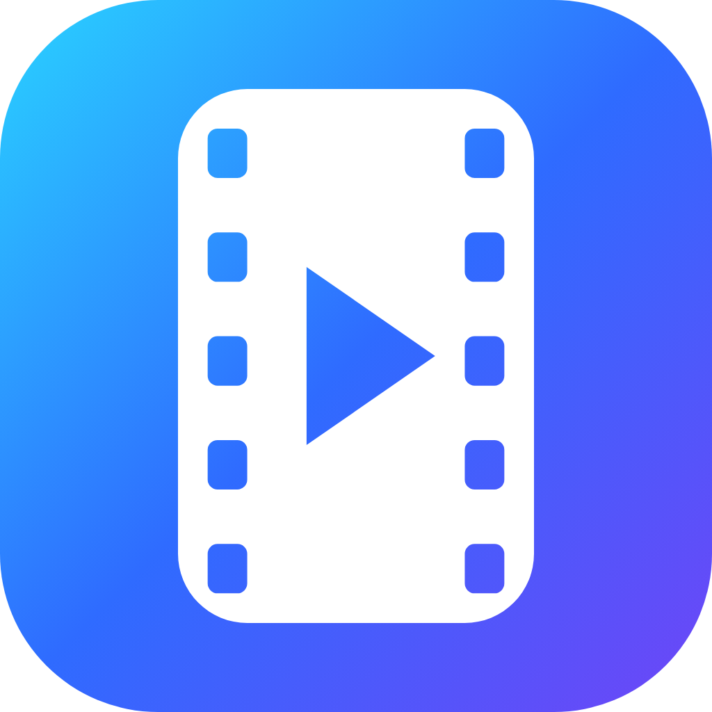

# ReelDrama

An ad-free Flutter app for Android phones and tablets, built for short-drama-style episodic viewing.

**APK:** `dist/ReelDrama-1.0.0-universal-release.apk` (minSdk 26 / Android 8.0, targetSdk 36; arm64-v8a, armeabi-v7a, x86_64) · **AAB:** `dist/ReelDrama-1.0.0-release.aab` · checksums in `dist/SHA256SUMS.txt`

> Signed with the Android debug key: installable, but not suitable for Play Store publishing. See BUILD_INSTRUCTIONS.md.

## Design
Short-drama home layout (full-bleed featured hero with **Discover / For you** tabs, then poster rows with genre tags) in a **blue Luminark-style palette**: deep navy, electric blue `#2F6BFF`, and a cyan→blue→violet glow. The structure is Apple-style: Inter on the iOS type scale, large collapsing titles, a floating frosted tab bar (Home · Explore · My List · Profile; a sidebar on tablets), inset grouped lists, action sheets, and swipe-back. Supports **light and dark mode** (Profile → Appearance). Design tokens came from the ui-ux-pro-max skill's guidance (contrast, touch targets, dark-mode parity). Details are in UI_COMPONENTS.md.

## What's in it
- Home: Discover (hero, continue watching, catalog and genre rows) and For you ("Because you watched…", unwatched titles); search from the hero
- Explore by catalog and genre · Search with suggestions and recent searches
- Drama detail: episode matrix (20-episode ranges, watched marks), related titles, bookmark, share, license attribution
- **Reels-style portrait player** (Media3 ExoPlayer): swipe up/down between episodes, full-bleed video, episode windows, auto-advance, resume, swipe/next/prev, server and quality switching, automatic quality fallback on slow networks, fit/fill, immersive full screen, error + retry
- My List: history (swipe to remove, clear) and bookmarks, all stored on the device (SQLite)
- Adaptive layout: tab bar on phones, sidebar at ≥840dp, two-pane detail and a player side panel on tablets
- No ads, no analytics, no accounts

## Content
- **Built-in:** 14 Blender open movies (CC BY / CC BY-SA) streamed from Wikimedia Commons, split into 57 short episodes.
- **Your own:** Settings → *Add catalog from URL* takes an HTTPS JSON catalog of media you are authorized to stream (format in DATA_MODELS.md).

## Repository layout
| Path | Contents |
|---|---|
| `reeldrama/` | Flutter project (`lib/`, `test/`, `integration_test/`, `assets/demo_catalog.json`) |
| `dist/` | Release APK and AAB |
| `screenshots/` | ReelDrama on the emulator (phone light/dark, tablet, reels player) |
| `tools/` | Catalog generator, icon generator (`build_icon.py`), adb helpers |

## Documentation
PROJECT_STATUS · UI_COMPONENTS · RESPONSIVE_DESIGN · DATA_MODELS · TEST_RESULTS · BUILD_INSTRUCTIONS

## Credits
Big Buck Bunny, Sintel, Tears of Steel, Elephants Dream, Spring, Sprite Fright, Charge, Coffee Run, Hero, Wing It!, Singularity, Glass Half, The Daily Dweebs and Caminandes are © Blender Foundation / Blender Studio, under the Creative Commons licenses listed per title in the app. The second Big Buck Bunny stream is Mux's public HLS test stream. The Inter typeface is licensed under the SIL Open Font License (`reeldrama/assets/fonts/OFL.txt`).
